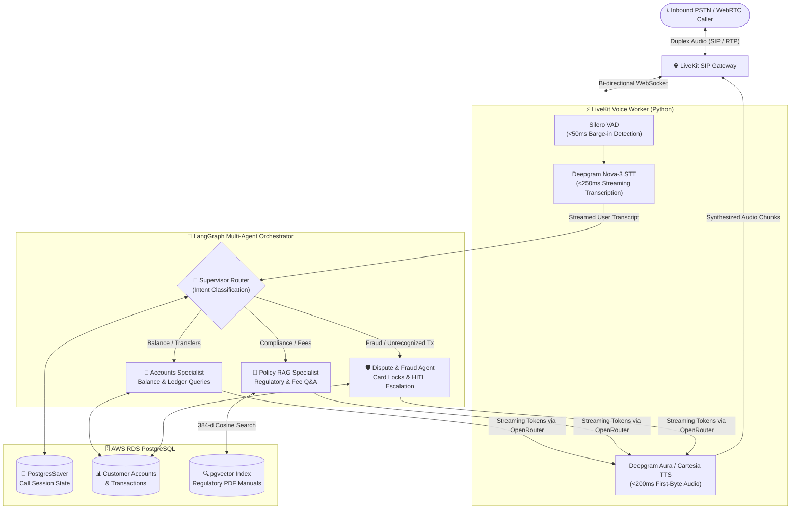

<div align="center">

# 🎙️ Autonomous Voice Banking Agent
### **Full-Duplex Multi-Agent RAG for Real-Time Telephony Support**

[](https://www.python.org/)
[](https://docs.livekit.io/agents/)
[](https://langchain-ai.github.io/langgraph/)
[](https://deepgram.com/)
[](https://openrouter.ai/)
[](https://github.com/pgvector/pgvector)

<p align="center">
  <em>A production-grade, sub-800ms latency conversational voice system bridging PSTN phone calls via LiveKit SIP trunks to a stateful LangGraph multi-agent supervisor backed by AWS RDS PostgreSQL and pgvector.</em>
</p>

[Architecture](#-system-architecture) •
[Key Features](#-key-features) •
[Tech Stack](#-tech-stack--latency-budget) •
[Quick Start](#-quick-start) •
[Deployment](#-running-the-agent)

</div>

---

## 🏗️ System Architecture

GitHub natively renders the Mermaid diagram below into a visual flow showing the real-time audio and token streaming pipeline:



---

## ✨ Key Features

| Capability | Technical Implementation |
| :--- | :--- |
| ⚡ **Sub-800ms Turnaround** | Pipes streaming LLM tokens from OpenRouter directly into real-time TTS chunk buffers without waiting for full sentence completion. |
| 🛑 **Natural Barge-In (VAD)** | Silero VAD continuously monitors incoming caller audio (<50ms window) and immediately flushes queued TTS audio when interrupted. |
| 📚 **Agentic Compliance RAG** | Queries `pgvector` HNSW indexes over chunked regulatory PDFs (200–350 tokens) to answer complex fee, wire, and policy inquiries. |
| 🔄 **Stateful Call Checkpointing** | Persists multi-turn conversation threads via `AsyncPostgresSaver`, enabling seamless context handoffs across specialist sub-agents. |
| 🗣️ **Phonetic Normalization** | Enforces strict spoken-word formatting (e.g., rendering `$1,240.50` as *"twelve hundred forty dollars and fifty cents"*) for natural prosody. |
| 🔒 **HITL Fraud Safeguards** | Isolates card-locking and dispute workflows behind human-in-the-loop verification flags and PII regex redaction. |

---

## 🛠️ Tech Stack & Latency Budget

| Layer | Technology | Model / Engine | Target Latency |
| :--- | :--- | :--- | :--- |
| **Telephony & RTC** | LiveKit Cloud & SIP | WebRTC / SIP Trunking | `~40ms` |
| **Voice Activity (VAD)** | Silero | `silero-vad` v5 | `<50ms` |
| **Speech-to-Text (STT)** | Deepgram | `nova-3` (Streaming WebSocket) | `180–250ms` |
| **Agent Orchestration** | LangGraph | `StateGraph` + `AsyncPostgresSaver` | `~15ms` |
| **LLM Brain** | OpenRouter | `meta-llama/llama-3.3-70b-instruct` | `150–250ms TTFT` |
| **Vector Embeddings** | HuggingFace | `all-MiniLM-L6-v2` (384 dims) | `~20ms` |
| **Text-to-Speech (TTS)** | Deepgram / Cartesia | `aura-asteria-en` / `sonic-english` | `150–200ms` |

---

## 📂 Project Structure

```text
banking-voice-agent/
├── .env.example                  # Template for environment credentials
├── .gitignore                    # Git exclusion rules
├── README.md                     # Project documentation
├── requirements.txt              # Python dependencies
├── src/
│   ├── config.py                 # Runtime constants & validated env settings
│   ├── voice/
│   │   ├── worker.py             # LiveKit entrypoint & SIP audio session loop
│   │   ├── adapter.py            # LangGraph-to-LiveKit streaming token bridge
│   │   └── prompts.py            # Phonetic & voice-concise system prompts
│   ├── agent/
│   │   ├── state.py              # BankingVoiceState TypedDict schema
│   │   ├── graph.py              # Compiled StateGraph & Postgres checkpointer
│   │   ├── nodes/                # Supervisor, Accounts, Policy RAG, Disputes
│   │   └── tools/                # RDS SQL queries & pgvector similarity search
│   ├── rag/
│   │   ├── ingest.py             # PDF regulatory manual chunker & vector upsert
│   │   └── embeddings.py         # Local HuggingFace embedding pipeline
│   └── db/
│       ├── session.py            # Async psycopg connection pool
│       └── schema.sql            # PostgreSQL + pgvector DDL schema
└── tests/                        # Routing & retrieval latency unit tests
```

---

## 🚀 Quick Start

### 1. Prerequisites
* **Python 3.10+** installed locally
* **PostgreSQL 15+** (AWS RDS or local) with the `vector` extension enabled
* **LiveKit Cloud** project with an inbound SIP phone number configured
* API keys for **OpenRouter**, **Deepgram**, and **LiveKit**

### 2. Installation

```bash
# Clone the repository
git clone [https://github.com/](https://github.com/)<your-username>/banking-voice-agent.git
cd banking-voice-agent

# Create and activate virtual environment
python -m venv venv
source venv/bin/activate  # Windows: venv\Scripts\activate

# Install dependencies
pip install -r requirements.txt
```

### 3. Environment Configuration

Copy the example configuration file and populate your credentials:

```bash
cp .env.example .env
```

```ini
# --- LiveKit Telephony & RTC ---
LIVEKIT_URL=wss://<project-name>.livekit.cloud
LIVEKIT_API_KEY=APIxxxxxxxxx
LIVEKIT_API_SECRET=secretxxxxxxxxx

# --- Speech & LLM Gateway ---
DEEPGRAM_API_KEY=xxxxxxxxxxxxxxxxxxxxxxxxxxxxxxxx
OPENROUTER_API_KEY=sk-or-v1-xxxxxxxxxxxxxxxxxxxx

# --- AWS RDS PostgreSQL & pgvector ---
DATABASE_URL=postgresql://postgres:password@<rds-endpoint>:5432/bank_agent
```

### 4. Database & Vector Index Initialization

Initialize the relational tables, `pgvector` extension, and HNSW cosine similarity index:

```bash
psql $DATABASE_URL -f src/db/schema.sql
```

Chunk and embed your regulatory PDF manuals into PostgreSQL:

```bash
python -m src.rag.ingest --source-dir ./documents/regulatory_manuals
```

---

## 🎧 Running the Agent

> [!TIP]
> **Zero-Cost Browser Testing:** Start with **Web Sandbox Mode** to test voice latency, barge-in interruptions, and multi-agent routing using your computer microphone before dialing via carrier telephony.

### Mode A: Local WebRTC Sandbox (Development)

```bash
python -m src.voice.worker dev
```
Open the LiveKit Agent Playground URL output in your terminal to converse with the banking supervisor directly in your browser.

### Mode B: Production Inbound SIP Telephony

```bash
python -m src.voice.worker start
```
1. Navigate to your **LiveKit Cloud Console → Telephony → Dispatch Rules**.
2. Point your inbound US/International SIP number to the worker queue (`banking-voice-agent`).
3. Call the provisioned telephone number from any mobile or landline phone.

---

## 🗺️ Roadmap

- [x] Multi-agent supervisor routing (Accounts, Policy RAG, Disputes)
- [x] AWS RDS `pgvector` integration for regulatory compliance manuals
- [x] Full-duplex interruption handling with Silero VAD
- [ ] Biometric voiceprint caller verification
- [ ] Warm call transfer (`SIP REFER`) to human banking specialists with live summary whisper
- [ ] Real-time Streamlit supervisor observability dashboard

---

<div align="center">
  <sub>Built with ❤️ using LiveKit, LangGraph, OpenRouter, and PostgreSQL</sub>
</div>